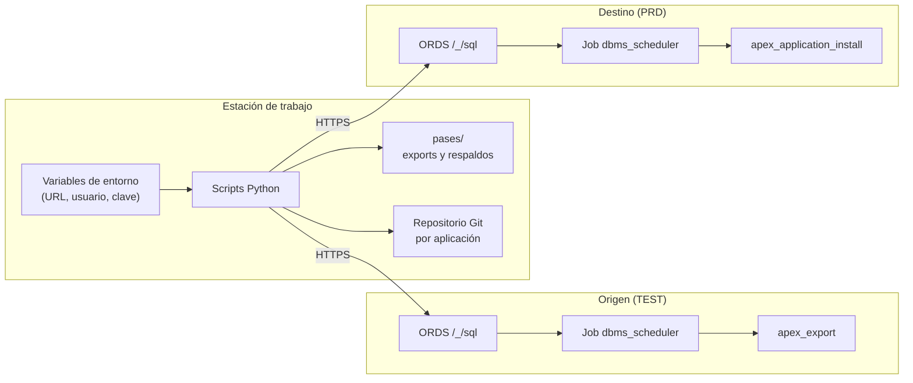

# apex-rest-deploy

Despliegue de páginas y aplicaciones Oracle APEX entre ambientes vía **ORDS REST Enabled SQL**, sin SQLcl, sin Oracle Net y sin wallet.

[Read in English](README.md)

## Por qué

Oracle Autonomous Database con el **tipo de workload APEX** no acepta conexiones Oracle Net, así que las herramientas habituales (SQLcl, Liquibase, SQLcl Projects) no pueden conectarse. Pasar cambios de TEST a PRD termina siendo un export/import manual en el App Builder.

Estas herramientas lo automatizan usando solo llamadas HTTPS a ORDS:

- Pase de **páginas sueltas** o **aplicaciones completas**, con sus dependencias.
- Creación de **objetos de base de datos** faltantes (tablas, triggers, paquetes...) antes de instalar.
- Mapeo de **IDs de componentes compartidos** entre ambientes.
- Entradas de **menú y breadcrumb** faltantes, en la misma transacción.
- Export de aplicaciones en formato **APEXlang** a un repositorio Git, escribiendo solo lo que cambió.

## Arquitectura



La exportación y la instalación corren como **jobs de la base**: el script lanza el job, consulta su estado cada pocos segundos y trae el resultado. Ninguna llamada HTTP queda abierta mientras la base trabaja, así que los balanceadores no cortan las operaciones largas.

| Script | Para qué sirve | Modifica el destino |
|---|---|---|
| `pase_apex.py` | Pasa páginas o apps completas con sus dependencias | Sí, tras confirmar |
| `sincronizar_objetos.py` | Crea objetos de base de datos faltantes (DDL con `dbms_metadata`) | Solo con `--aplicar` |
| `comparar_paginas.py` | Compara páginas entre ambientes y genera un CSV | No |
| `exportar_apexlang.py` | Export APEXlang incremental a una carpeta local | No (escribe archivos locales) |

## Requisitos

- Python 3.9+ y `requests` (`pip install requests`).
- ORDS **REST Enabled SQL** habilitado en ambos ambientes.
- Un usuario de base de datos que pueda exportar/instalar aplicaciones APEX y leer el diccionario (probado con `ADMIN` en Autonomous Database). Los scripts crean dos tablas de trabajo en su schema: `PASE_APEX_EXPORTS` y `PASE_APEX_FILES`.
- Probado con APEX 26.1.

## Configuración

Las credenciales se leen desde variables de entorno, nunca desde el código:

| Variable | Ejemplo |
|---|---|
| `TEST_URL` | `https://<host-test>/ords/admin` |
| `TEST_USER` / `TEST_PASS` | usuario y clave de TEST |
| `PRD_URL` | `https://<host-prd>/ords/admin` |
| `PRD_USER` / `PRD_PASS` | usuario y clave de PRD |

En Windows (CMD), y luego abrir una terminal nueva:

```
setx TEST_URL "https://<host-test>/ords/admin"
setx TEST_USER "ADMIN"
setx TEST_PASS "<clave>"
```

En PowerShell, usar comillas simples si la clave contiene `$`.

Opcional, para hacer commits por aplicación: un archivo `repos_git.json` junto a los scripts:

```json
{ "100": "C:/repos/app-100", "200": "C:/repos/app-200" }
```

## Uso

### Pase de páginas

```
python pase_apex.py --app 100 --paginas 10,20 --workspace MI_WS --schema MI_SCHEMA
```

Pasos: verifica que ambas apps compartan IDs internos → exporta (job) → mapea componentes compartidos, detecta entradas de menú/breadcrumb y objetos de BD faltantes (pregunta `s/n` por cada uno) → respalda las páginas que se reemplazan → confirmación escribiendo el nombre del destino → crea los objetos e instala (job, una sola transacción).

### Pase de aplicación completa

```
python pase_apex.py --app 100 --workspace MI_WS --schema MI_SCHEMA
```

### Otros modos

| Modo | Comando |
|---|---|
| Refrescar TEST desde PRD | `--desde PRD --hacia TEST --app 100` |
| Copia con otro ID | `--app 100 --app-destino 9100` |
| Misma app con distinto ID en cada ambiente | `--app 166 --app-destino 100 --reemplazar` |

### Opciones principales

| Opción | Descripción |
|---|---|
| `--sql archivo.sql` | Ejecuta scripts SQL en el destino antes de instalar (repetible) |
| `--sin-respaldo` | Omite el respaldo del destino |
| `--sin-objetos` | Omite la revisión de objetos de BD y componentes compartidos |
| `--sin-menu` | Omite las entradas de menú y breadcrumb |
| `--con-componentes` | Incluye en el export los componentes compartidos faltantes |
| `--forzar` | Instala aunque no coincidan nombres de página o IDs internos |
| `--mensaje "texto" --push` | Commit (y push) de la versión instalada en el repo Git de la app |
| `--yes` | Sin confirmaciones (automatización) |

### Objetos de base de datos

```
python sincronizar_objetos.py --schema MI_SCHEMA                        # informa y genera el DDL
python sincronizar_objetos.py --schema MI_SCHEMA --aplicar              # crea los faltantes
python sincronizar_objetos.py --schema MI_SCHEMA --solo TABLA1,TRG1 --aplicar
```

### Comparar páginas

```
python comparar_paginas.py --app 100
python comparar_paginas.py --app-test 166 --app-prd 100
```

### Export APEXlang

```
python exportar_apexlang.py --app 100 --ambiente PRD --dir "C:/repos/app-100"
```

La base genera el export completo; localmente solo se escriben los archivos nuevos o modificados (ignorando diferencias CRLF/LF), y los archivos estáticos se sincronizan byte a byte. Opciones: `--solo "*pagina*"`, `--borrar-sobrantes`, `--limpiar`, `--sin-estaticos`.

## Decisiones de diseño

| Decisión | Motivo |
|---|---|
| ORDS REST Enabled SQL | El workload APEX no permite Oracle Net |
| Jobs + consulta de estado | Los balanceadores cortan en silencio las respuestas HTTP lentas |
| Mapeo de IDs por tipo y nombre | Permite instalar páginas aunque un componente tenga otro ID interno en el destino |
| Verificación de IDs internos alineados | Evita instalar páginas que apuntarían a componentes inexistentes |
| Entradas de menú y breadcrumb dentro del archivo de instalación | Todo se aplica en una transacción; si falla, APEX deshace todo |
| Confirmación escribiendo el nombre del destino | Reduce el riesgo de pasar al ambiente equivocado |

## Limitaciones

- Los cambios en objetos de BD **existentes** (columnas nuevas, PL/SQL modificado) se informan pero no se aplican; se pasan con `--sql`.
- No copia datos de tablas.
- Las entradas de menú y breadcrumb usan APIs internas de APEX (`wwv_flow_imp_shared`), verificadas en APEX 26.1. Volver a probar tras actualizar APEX.
- Los números de página deben coincidir entre ambientes.

## Seguridad

- Nunca subir credenciales. Mantener `pases/`, los CSV y `repos_git.json` fuera del repositorio (ver `.gitignore`).
- Preferir un usuario dedicado para despliegues en lugar de `ADMIN`, con claves distintas por ambiente.

## Licencia

MIT
