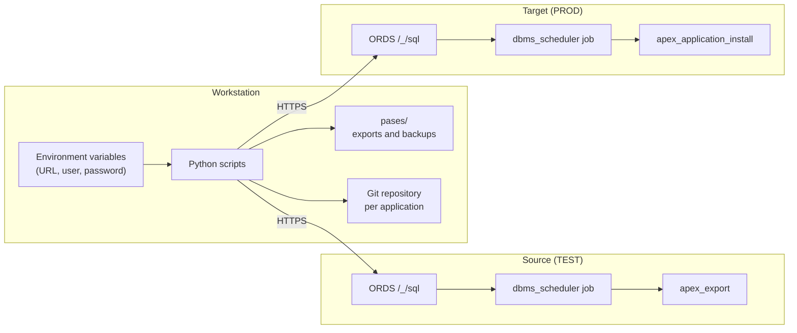

# apex-rest-deploy

Deploy Oracle APEX pages and applications between environments over **ORDS REST Enabled SQL** — no SQLcl, no Oracle Net, no wallet.

[Leer en español](README.es.md)

## Why

Oracle Autonomous Database with the **APEX workload type** does not accept Oracle Net connections, so the usual tools (SQLcl, Liquibase, SQLcl Projects) cannot connect. Promoting changes from TEST to PROD ends up being a manual export/import in the App Builder.

This toolset automates it using only HTTPS calls to ORDS:

- Deploy **single pages** or **full applications**, with their dependencies.
- Create missing **database objects** (tables, triggers, packages...) before installing.
- Map **shared component IDs** between environments.
- Add missing **menu and breadcrumb entries** in the same transaction.
- Export applications in **APEXlang** format to a Git repository, writing only what changed.

## Architecture



Exports and installs run as **database jobs**: the script launches the job, polls its status every few seconds and fetches the result. No HTTP call stays open while the database works, so long operations are not cut by load balancers.

| Script | Purpose | Changes the target |
|---|---|---|
| `pase_apex.py` | Deploy pages or full apps with their dependencies | Yes, after explicit confirmation |
| `sincronizar_objetos.py` | Create missing database objects (DDL from `dbms_metadata`) | Only with `--aplicar` |
| `comparar_paginas.py` | Compare pages between environments, export a CSV | No |
| `exportar_apexlang.py` | Incremental APEXlang export to a local folder | No (writes local files) |

> The command-line messages and option names are in Spanish.

## Requirements

- Python 3.9+ and `requests` (`pip install requests`).
- ORDS **REST Enabled SQL** enabled on both environments.
- A database user able to export/install APEX applications and read the data dictionary (tested with `ADMIN` on Autonomous Database). The scripts create two work tables in that user's schema: `PASE_APEX_EXPORTS` and `PASE_APEX_FILES`.
- Tested with APEX 26.1.

## Configuration

Credentials are read from environment variables, never from the code:

| Variable | Example |
|---|---|
| `TEST_URL` | `https://<test-host>/ords/admin` |
| `TEST_USER` / `TEST_PASS` | user and password for TEST |
| `PRD_URL` | `https://<prod-host>/ords/admin` |
| `PRD_USER` / `PRD_PASS` | user and password for PROD |

Windows (CMD), then open a new terminal:

```
setx TEST_URL "https://<test-host>/ords/admin"
setx TEST_USER "ADMIN"
setx TEST_PASS "<password>"
```

In PowerShell use single quotes if the password contains `$`.

Optional, for Git commits per application: a `repos_git.json` file next to the scripts:

```json
{ "100": "C:/repos/app-100", "200": "C:/repos/app-200" }
```

## Usage

### Deploy pages

```
python pase_apex.py --app 100 --paginas 10,20 --workspace MY_WS --schema MY_SCHEMA
```

Steps: verify that both apps share internal IDs → export (job) → map shared components, detect missing menu/breadcrumb entries and database objects (asks `s/n` for each) → back up replaced pages → confirm by typing the target name → create objects and install (job, single transaction).

### Deploy a full application

```
python pase_apex.py --app 100 --workspace MY_WS --schema MY_SCHEMA
```

### Other modes

| Mode | Command |
|---|---|
| Refresh TEST from PROD | `--desde PRD --hacia TEST --app 100` |
| Copy with a new ID | `--app 100 --app-destino 9100` |
| Same app, different ID per environment | `--app 166 --app-destino 100 --reemplazar` |

### Main options

| Option | Description |
|---|---|
| `--sql file.sql` | Run SQL scripts on the target before installing (repeatable) |
| `--sin-respaldo` | Skip the backup of the target |
| `--sin-objetos` | Skip database object and shared component checks |
| `--sin-menu` | Skip menu and breadcrumb entries |
| `--con-componentes` | Include missing shared components in the export |
| `--forzar` | Install even if page names or internal IDs do not match |
| `--mensaje "text" --push` | Commit (and push) the deployed version to the app's Git repository |
| `--yes` | No confirmations (automation) |

### Database objects

```
python sincronizar_objetos.py --schema MY_SCHEMA                       # report and generate DDL
python sincronizar_objetos.py --schema MY_SCHEMA --aplicar             # create missing objects
python sincronizar_objetos.py --schema MY_SCHEMA --solo TABLE1,TRG1 --aplicar
```

### Compare pages

```
python comparar_paginas.py --app 100
python comparar_paginas.py --app-test 166 --app-prd 100
```

### APEXlang export

```
python exportar_apexlang.py --app 100 --ambiente PRD --dir "C:/repos/app-100"
```

The database generates a full export; locally only new or changed files are written (ignoring CRLF/LF differences), and static files are synced byte by byte. Options: `--solo "*page*"`, `--borrar-sobrantes`, `--limpiar`, `--sin-estaticos`.

## Design decisions

| Decision | Reason |
|---|---|
| ORDS REST Enabled SQL | The APEX workload type does not allow Oracle Net |
| Jobs + status polling | Load balancers silently drop slow HTTP responses |
| Shared component ID mapping by type and name | Lets pages install even when a component has a different internal ID in the target |
| Internal ID alignment check | Prevents installing pages that point to missing components |
| Menu and breadcrumb entries inside the install file | Everything is applied in one transaction; on error APEX rolls back |
| Explicit confirmation typing the target name | Reduces the risk of deploying to the wrong environment |

## Limitations

- Changes in **existing** database objects (new columns, modified PL/SQL) are reported but not applied; deploy them with `--sql`.
- Table data is not copied.
- Menu and breadcrumb entries use internal APEX APIs (`wwv_flow_imp_shared`), verified on APEX 26.1. Re-test after upgrading APEX.
- Page numbers must match between environments.

## Security

- Never commit credentials. Keep `pases/`, CSV files and `repos_git.json` out of the repository (see `.gitignore`).
- Prefer a dedicated deployment user over `ADMIN`, with different passwords per environment.

## License

MIT
